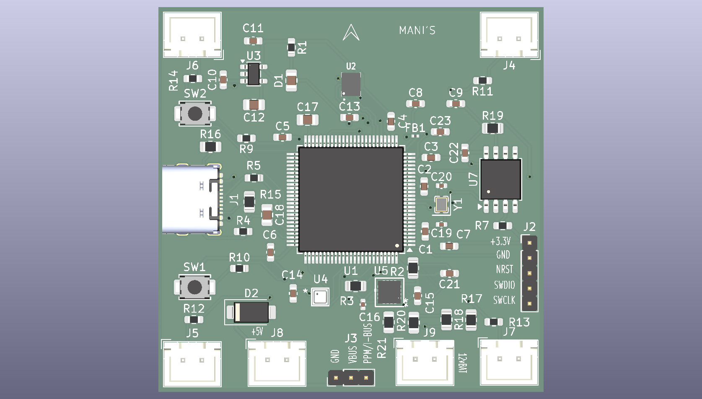
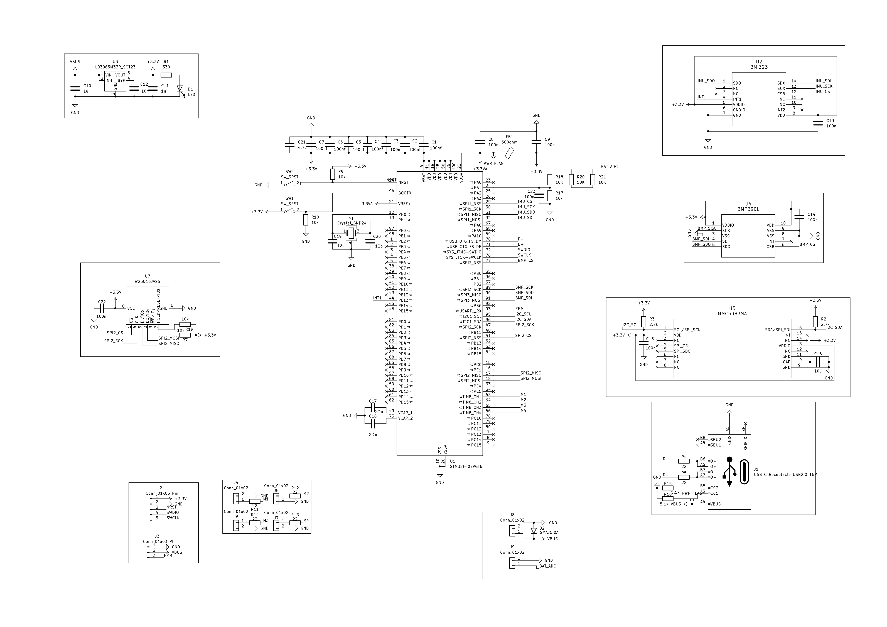

# Flight Controller PCB

A custom-designed flight controller board built around the **STM32F407VGT6** microcontroller, featuring a full 10-DOF IMU sensor suite (accelerometer, gyroscope, barometer, magnetometer), USB-C connectivity, and 16 Mbit onboard flash storage. Designed in **KiCad 10.0**.

---

##  Board Preview

### PCB Layout (3D Render)


### Schematic


---

## Key Features

- **MCU:** STM32F407VGT6 — ARM Cortex-M4 @ 168 MHz, 1 MB Flash, 192 KB RAM (LQFP-100)
- **IMU:** Bosch BMI323 — 6-axis accelerometer + gyroscope (SPI)
- **Barometer:** Bosch BMP390L — high-precision pressure/altitude sensor
- **Magnetometer:** MEMSIC MMC5983MA — 3-axis magnetic field sensor
- **Flash Memory:** Winbond W25Q16JVSS — 16 Mbit SPI NOR flash
- **Power:** LD3985M33R — 3.3 V LDO voltage regulator (SOT-23-5)
- **Interface:** USB Type-C 2.0 (16-pin receptacle)
- **ESD Protection:** SMAJ5.0A TVS diode on power input
- **6× Motor / Servo outputs** via JST-XH 2-pin connectors
- **Debug / Peripheral headers:** 1×5 pin and 1×3 pin (2.00 mm pitch)
- **Status LED** and **2× Tactile switches** (BOOT / RESET)
- **Crystal oscillator** — SMD 2016 package (HSE for STM32)

---

## Connectors

| Ref | Connector | Type | Purpose |
|-----|-----------|------|---------|
| J1  | USB Type-C 16P | Palconn UTC16-G | USB 2.0 data + power |
| J2  | 1×05 Pin Header | 2.00 mm pitch | Debug / UART / SWD |
| J3  | 1×03 Pin Header | 2.00 mm pitch | Peripheral (e.g. GPS / RX) |
| J4–J9 | JST-XH 2-pin (×6) | 2.50 mm pitch | Motor / Servo / ESC outputs |

---

## PCB Specifications

| Parameter | Value |
|-----------|-------|
| Layers | 2 (F.Cu + B.Cu) |
| Board Thickness | 1.6 mm |
| Copper Thickness | 35 µm |
| Substrate | FR4 (εr = 4.5) |
| Smallest SMD Package | 0201 (0603 Metric) |
| Design Tool | KiCad 10.0.3 |

---

## Bill of Materials (Summary)

| Category | Components | Details |
|----------|------------|---------|
| MCU | U1 — STM32F407VGT6 | LQFP-100 |
| IMU | U2 — BMI323 | 6-axis accel + gyro |
| LDO | U3 — LD3985M33R | 3.3 V regulator |
| Barometer | U4 — BMP390L | Pressure / altitude |
| Magnetometer | U5 — MMC5983MA | 3-axis compass |
| Flash | U7 — W25Q16JVSS | 16 Mbit SPI NOR |
| Capacitors | C1–C23 (23 total) | 12 pF – 10 µF, 0402–0805 |
| Resistors | R1–R19 (17 total) | 22 Ω – 100 kΩ, 0201–0805 |
| Diodes | D1 (LED), D2 (TVS) | Status indicator + ESD |
| Crystal | Y1 | SMD 2016, 4-pin |
| Ferrite Bead | FB1 — 600 Ω | EMI filtering (0201) |
| Switches | SW1, SW2 | SPST tactile (BOOT / RESET) |
| Connectors | J1–J9 | USB-C, pin headers, JST-XH |

> **Total unique part count:** ~31 line items &nbsp;|&nbsp; **Total components:** ~65+

---

## Project Structure

```
Flightcontroller/
├── flight.kicad_pro          # KiCad project file
├── flight.kicad_sch          # Schematic
├── flight.kicad_pcb          # PCB layout
├── flight.kicad_prl          # Local project preferences
├── flight.csv                # BOM export
├── flight.xml                # Netlist / BOM XML export
├── place_footprints.log      # Footprint placement log
└── README.md                 # This file
```

---

## Getting Started

### Prerequisites
- [KiCad 10.0+](https://www.kicad.org/download/) installed

### Open the Project
1. Clone or download this repository
2. Open `flight.kicad_pro` in KiCad
3. Use the Schematic Editor to view/edit the circuit
4. Use the PCB Editor to view/edit the board layout

```bash
git clone https://github.com/manikanta6153/Flightcontroller.git
cd Flightcontroller
```

---

## Sensor Communication Interfaces

| Sensor | IC | Interface | Notes |
|--------|----|-----------|-------|
| Accel + Gyro | BMI323 | SPI | 6-axis IMU |
| Barometer | BMP390L | SPI / I²C | Altitude estimation |
| Magnetometer | MMC5983MA | SPI / I²C | Heading / compass |
| Flash | W25Q16JVSS | SPI | Blackbox / config storage |

---

## License

This is an open hardware project. See the repository for license details.

---
